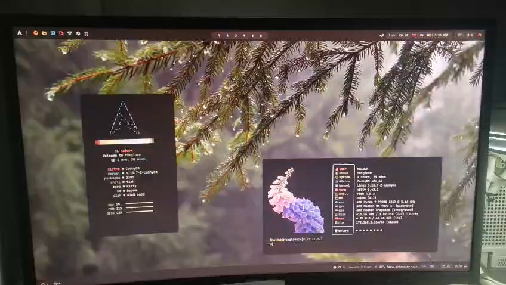

# fox-bspwm

Backup of my old X11 bspwm dotfiles, using the **foxglove** rice.

Based on [gh0stzk/dotfiles](https://github.com/gh0stzk/dotfiles). The scripts expect this folder to live at `~/.config/bspwm`.

The OpenWeatherMap key in `bin/Weather` has been replaced with a placeholder.
I also removed all but 1 wallpaper, as it would surpass the file limit on github.
